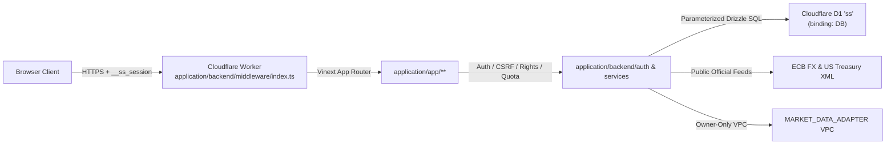

<p align="center">
  
</p>

# Strategic Souls

**Financial Market Research & Quantitative Accountability Platform — by Global Vertex Vectors (GVV)**

Strategic Souls turns market hypotheses into immutable, audit-stamped research records with explicit opposing cases, deterministic rule screening, multi-currency cost accounting, and private research collaboration.

> **Before editing any file or adding rules:** Agents and contributors must read the engineering governance rules in [`application/AGENTS.md`](application/AGENTS.md) and review [`documentation/SECURITY_AND_DATA_RIGHTS.md`](documentation/SECURITY_AND_DATA_RIGHTS.md).

---

## Current Verified Status & Explicit Limitations

- **Active Keyless Functionality:** Official daily **ECB Euro FX reference rates** (`13` currency pairs) and **US Treasury par yields** (15-minute shared D1 cache with source dates and retrieval timestamps), interactive 3D NASA Earth globe (`24` ISO 10383 MIC exchanges + dynamic regional map), consent-gated TradingView widgets, manual watchlists, manual multi-currency portfolio ledger, deterministic Formula Lab, Classic (`50` presets) & Advanced (`Discover` / `Build` / `Draw`) Soul Scan, immutable Graveyard reviews, and standalone D1 authentication + private community Chats/Rooms.
- **Private Owner Broker Path:** Read-only Angel One SmartAPI connectivity (`NSE`, `BSE`, `MCX`) operates exclusively for the configured owner (`X2_OWNER_SUBJECT`) through the `MARKET_DATA_ADAPTER` Cloudflare Workers VPC binding and loopback adapter.
- **Honest External Limits (Gated / Unavailable):** Public multi-user NSE / Nifty 500 scanning, raw commercial OHLCV charts, BSE/MCX public feeds, intraday `30m`/`1h` public scans, billing/checkout, payments, and advertisements remain **disabled or blocked** until commercial exchange/constituent redistribution licences and legal/SEBI/DPDP reviews are completed. No security certifications, live market claims without entitlement, or simulated prices are made.

---

## Repository Structure (Five Top-Level Folders)

All JavaScript/TypeScript application source, tests, build configuration, and dependencies live inside **`application/`** rather than the Git root:

```text
strategic-souls/
├── .github/                  # CI workflows & five-folder root/secret invariant checks
├── application/              # Vinext / Next App Router / Cloudflare Worker project root
│   ├── app/                  # Pages, layouts & /api/* route handlers
│   ├── backend/              # Auth, Worker middleware/security, AST/math engines, services, Python quant
│   ├── database/             # Drizzle ORM SQLite schemas & D1 repositories
│   ├── frontend/             # Workspace shell, feature modules, styles, client helpers
│   ├── public/               # Static assets served at / (GVV logo, WOFF2 fonts, avatars, Earth textures)
│   ├── scripts/              # Managed CI installer entrypoint (scripts/install-pnpm.sh)
│   ├── tests/                # Unit & integration test suites (D1 SQLite + PGlite Postgres)
│   └── tooling/              # App-local build, local-preview, pnpm install & release check runners
├── database/                 # Canonical 21 D1 SQL migrations (0000–0020) + Supabase V3 migrations
├── documentation/            # Architecture, setup, market data, licensing/rights, changelog & specs
├── operations/               # Deployment/rollback runbook, operational scripts & cleanup manifests
└── README.md                 # This repository entry point
```

---

## Request & Execution Lifecycle



---

## Technology Stack

- **Frontend & Styling:** React 19, Next.js App Router conventions via Vinext (`1.0.0-beta.5`), custom CSS token system (`--x1-*`), WebGL2/WebGL1 NASA Earth shader, MapLibre GL, self-hosted SIL OFL fonts (`Space Grotesk`, `Inter`, `IBM Plex Mono`).
- **Backend & Edge Runtime:** Cloudflare Workers (`nodejs_compat`), Vite + `@cloudflare/vite-plugin`, Drizzle ORM (`0.45.2`) over Cloudflare D1 SQLite, deterministic AST & option math engines in TypeScript.
- **Optional Local / Quant Tooling:** Local Supabase PostgreSQL RLS stack (`database/supabase/`) verified in Node via `@electric-sql/pglite`, plus Python quantitative evaluator (`application/backend/quant/`, `duckdb`, `numpy`, `pyarrow`).
- **Package Manager & CI:** `pnpm@11.25.0`, Node.js `>=22.13.0` (`node:sqlite` + `--experimental-strip-types`), GitHub Actions.

---

## Local Setup, Verification & Preview

All application commands run from inside **`application/`**:

```powershell
cd application
corepack enable
pnpm install --frozen-lockfile
```

Run full typecheck, ESLint, and Node unit/integration suites:

```powershell
cd application
pnpm run verify
```

Build the production Cloudflare Worker bundle, verify Worker/D1/VPC bindings, check repository invariants, and scan for secrets:

```powershell
cd application
pnpm run build
node ../operations/scripts/check-production-release.mjs artifact
node ../operations/scripts/check-repo-layout.mjs
node ../operations/scripts/scan-secrets.mjs
```

Launch isolated compiled-Worker + local D1 preview (applies `database/migrations/` to `application/.wrangler/local-preview` and serves at `http://127.0.0.1:5173`):

```powershell
cd application
pnpm run dev
```

Run optional Python quant tests (if `uv` is installed):

```powershell
cd application
pnpm run test:quant
```

---

## Documentation & Governance Map

| Topic | Location |
| --- | --- |
| **Engineering Rules & Invariants** | [`application/AGENTS.md`](application/AGENTS.md) |
| **System Architecture & Design System** | [`documentation/ARCHITECTURE.md`](documentation/ARCHITECTURE.md) |
| **Local Development, Env & Tooling** | [`documentation/DEVELOPMENT.md`](documentation/DEVELOPMENT.md) |
| **Market Data, Broker VPC & Capacity** | [`documentation/MARKET_DATA.md`](documentation/MARKET_DATA.md) |
| **Security, Legal Gates & Data Rights** | [`documentation/SECURITY_AND_DATA_RIGHTS.md`](documentation/SECURITY_AND_DATA_RIGHTS.md) |
| **Database Migrations & Recovery** | [`database/README.md`](database/README.md) |
| **Deployment & Rollback Runbook** | [`operations/deployment/DEPLOYMENT_RUNBOOK.md`](operations/deployment/DEPLOYMENT_RUNBOOK.md) |
| **Changelog & Cleanup Manifest** | [`documentation/CHANGELOG.md`](documentation/CHANGELOG.md), [`operations/reports/CLEANUP_AND_RESTRUCTURE_MANIFEST.md`](operations/reports/CLEANUP_AND_RESTRUCTURE_MANIFEST.md) |
| **Provenance & Attribution** | [`documentation/SOURCE_PROVENANCE.json`](documentation/SOURCE_PROVENANCE.json), [`documentation/specs/GLOBE_ASSET_RIGHTS.md`](documentation/specs/GLOBE_ASSET_RIGHTS.md) |

---

## Environment Variables (Names Only — Never Commit Values)

Local templates live at [`application/.env.example`](application/.env.example) and [`application/.dev.vars.example`](application/.dev.vars.example). Configure real secrets strictly inside Cloudflare Worker Encrypted Secrets or gitignored `application/.secrets/` / `application/.dev.vars`:

- **Worker Bindings & Vars:** `DB`, `MARKET_DATA_ADAPTER`, `CF_VERSION_METADATA`, `ENABLE_PRIVATE_BROKER_DATA`, `INDIA_API_HOST`
- **Server-Only Secrets:** `X2_OWNER_SUBJECT`, `MARKET_ADAPTER_AUTH_TOKEN`, `BHARATSTOCK_API_KEY`, `INDIA_API_KEY`, `X2_EODHD_API_TOKEN`, `X2_TRUEDATA_BEARER_TOKEN`, `CF_ACCESS_CLIENT_ID`, `CF_ACCESS_CLIENT_SECRET`, `GOOGLE_CLIENT_ID`, `GOOGLE_CLIENT_SECRET`, `SS_NEWS_API_KEY`
- **Local Loopback Adapter (`.secrets/angelone.env` only):** `ANGELONE_API_KEY`, `ANGELONE_CLIENT_ID`, `ANGELONE_MPIN`, `ANGELONE_TOTP_SECRET`
- **Optional Local V3 Stack:** `SUPABASE_URL`, `SUPABASE_PUBLISHABLE_KEY`, `V3_LOCAL_DEV`, `V3_GOOGLE_ENABLED`, `V3_QUANT_ENABLED`

---

## Contributing & Licensing Notes

- Branch cleanly from `main`, keep runtime changes scoped under `application/`, additive D1 SQL migrations under `database/migrations/`, and verify `node operations/scripts/check-repo-layout.mjs`, `pnpm run verify`, `pnpm run build`, and `scan-secrets.mjs` before opening a PR.
- No open-source repository license has been assigned by the owner; existing third-party notices remain preserved alongside their assets (`Space Grotesk`, `Inter`, `IBM Plex Mono` SIL OFL in `application/public/fonts/`, MapLibre GL notice in `application/public/data/maplibre-license.txt`, and NASA Blue/Black Marble historical imagery attribution).
