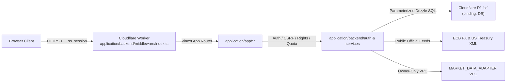

<p align="center">
  
</p>

# Strategic Souls

**Financial Market Research & Quantitative Accountability Platform — by Global Vertex Vectors (GVV)**

Strategic Souls turns market hypotheses into immutable, audit-stamped research records with explicit opposing cases, deterministic rule screening, multi-currency cost accounting, and private research collaboration.

- **Current Product Identity:** `Strategic Souls` (`V3.1` release track, `X 1.1` workspace experience, package `3.1.0`). Internal route/table prefixes (`x1`, `x2`, `x51`, `x78`, `v3`) reflect preserved compatibility and schema contracts rather than separate products.
- **Before editing any file or adding rules:** Read [`application/AGENTS.md`](application/AGENTS.md) and [`documentation/SECURITY_AND_DATA_RIGHTS.md`](documentation/SECURITY_AND_DATA_RIGHTS.md).

---

## Current Verified Status & Explicit Limitations

- **Active Keyless Functionality:** Official daily **ECB Euro FX reference rates** (`13` currency pairs) and **US Treasury par yields** (15-minute shared D1 cache with source dates and retrieval timestamps), interactive 3D NASA Earth globe (`24` ISO 10383 MIC exchanges + lazy regional MapLibre map), consent-gated TradingView widgets, manual watchlists, manual multi-currency portfolio ledger, deterministic Formula Lab, Classic (`50` presets) & Advanced (`Discover` / `Build` / `Draw`) Soul Scan, immutable Graveyard reviews, and standalone D1 email/password authentication + private community Chats/Rooms.
- **Private Owner Broker Path:** Read-only Angel One SmartAPI connectivity (`NSE`, `BSE`, `MCX`) operates exclusively for the configured owner (`X2_OWNER_SUBJECT`) through the `MARKET_DATA_ADAPTER` Cloudflare Workers VPC binding and loopback adapter.
- **Honest External Limits (Gated / Unavailable):** Public multi-user NSE / Nifty 500 scanning, raw commercial OHLCV charts, BSE/MCX public feeds, intraday `30m`/`1h` public scans, billing/checkout, payments, and advertisements remain **disabled or blocked** until commercial exchange/constituent redistribution licences and legal/SEBI/DPDP reviews are completed. No security certifications, live market claims without entitlement, or simulated prices are made.

---

## Repository Structure (Six Top-Level Folders)

All JavaScript/TypeScript application source, tests, build configuration, and dependencies live inside **`application/`** rather than the Git root:

```text
strategic-souls/
├── .github/                  # 1. CI workflows, composite setup action, scheduled monitor & issue templates
├── application/              # 2. Vinext / Next App Router / Cloudflare Worker project root
│   ├── app/                  #    Pages, layouts & /api/* route handlers (including /api/health)
│   ├── backend/              #    Auth, Worker middleware/security, engines, services, Python quant
│   ├── database/             #    Runtime Drizzle ORM SQLite schemas & D1 repositories
│   ├── frontend/             #    Workspace shell, feature modules, styles, client helpers
│   ├── public/               #    Static assets served at / (GVV logo, WOFF2 fonts, avatars, Earth textures)
│   ├── scripts/              #    Managed CI installer entrypoint (scripts/install-pnpm.sh)
│   ├── tests/                #    Unit & integration test suites (D1 SQLite + PGlite Postgres)
│   └── tooling/              #    App-local build, local-preview, pnpm install & release check runners
├── archive/                  # 3. Non-runtime historical reference material only (no code/SQL/secrets)
├── database/                 # 4. Canonical 21 D1 SQL migrations (0000–0020) + optional V3 Supabase migrations
├── documentation/            # 5. Authoritative architecture, setup, market data, rights, changelog & specs
├── operations/               # 6. Deployment/rollback runbooks, operational scripts & production monitoring
└── README.md                 # Sole root-level file; repository navigation entry
```

---

## Request & Execution Lifecycle



---

## Five-Minute Developer Start

### 1. Prerequisites
- **Node.js** `>= 22.13.0` (CI runs Node `24`)
- **pnpm** `11.25.0` (`packageManager` in `application/package.json`)
- **Python + `uv`** (optional, for `application/backend/quant` pytest suite)

### 2. Install & Verify (from `application/`)
```powershell
cd application
corepack enable
pnpm install --frozen-lockfile
pnpm run verify
```

### 3. Build, Release Artifact, Layout & Secret Checks
```powershell
cd application
pnpm run build
node ../operations/scripts/check-production-release.mjs artifact
node ../operations/scripts/check-repo-layout.mjs
node ../operations/scripts/scan-secrets.mjs
node --test ../operations/scripts/check-repo-layout.test.mjs ../operations/monitoring/monitor.test.mjs
```

### 4. Local Compiled-Worker Preview & Optional Quant Tests
```powershell
cd application
pnpm run dev        # Applies database/migrations/* to .wrangler/local-preview -> http://127.0.0.1:5173
pnpm run test:quant # Optional Python quant tests via uv
```

---

## Developer Task-to-Path Map

| Area / Task | Primary Implementation Paths |
| --- | --- |
| **Workspace Shell & Global Menu** | [`application/frontend/components/workspace/workspace.tsx`](application/frontend/components/workspace/workspace.tsx), [`global-menu.ts`](application/frontend/components/workspace/global-menu.ts), [`eclipse-intro.tsx`](application/frontend/components/workspace/eclipse-intro.tsx) |
| **Global Dashboard & Market Cards** | [`application/frontend/features/global/dashboard.tsx`](application/frontend/features/global/dashboard.tsx), [`market-grid.tsx`](application/frontend/features/global/market-grid.tsx), [`application/backend/services/market-data/nine-card-markets.ts`](application/backend/services/market-data/nine-card-markets.ts) |
| **Strategic Globe & Regional Map** | [`application/frontend/features/global/strategic-globe.tsx`](application/frontend/features/global/strategic-globe.tsx), [`globe-canvas.tsx`](application/frontend/features/global/globe-canvas.tsx), [`regional-map.tsx`](application/frontend/features/global/regional-map.tsx), [`application/backend/services/market-data/globe.ts`](application/backend/services/market-data/globe.ts) |
| **Economic Calendar & Market Vox** | [`application/frontend/features/global/economic-calendar.tsx`](application/frontend/features/global/economic-calendar.tsx), [`daily-pulse.tsx`](application/frontend/features/global/daily-pulse.tsx), [`application/backend/services/market-data/economic-calendar.ts`](application/backend/services/market-data/economic-calendar.ts), [`daily-pulse.ts`](application/backend/services/market-data/daily-pulse.ts) |
| **Portfolio & Watchlist** | [`application/frontend/features/global/portfolio-allocation.tsx`](application/frontend/features/global/portfolio-allocation.tsx), [`application/backend/engines/portfolio.ts`](application/backend/engines/portfolio.ts) |
| **Heatmap & Sector Explorer** | [`application/frontend/features/global/sector-explorer.tsx`](application/frontend/features/global/sector-explorer.tsx), [`application/backend/services/market-data/industry-heatmap.ts`](application/backend/services/market-data/industry-heatmap.ts), [`sectors-and-ecosystem.ts`](application/backend/services/market-data/sectors-and-ecosystem.ts) |
| **Soul Scan (Classic & Advanced)** | [`application/frontend/features/strategy/workspace.tsx`](application/frontend/features/strategy/workspace.tsx), [`scan-helpers.ts`](application/frontend/features/strategy/scan-helpers.ts), [`draw-canvas.tsx`](application/frontend/features/strategy/draw-canvas.tsx), [`application/backend/engines/scan.ts`](application/backend/engines/scan.ts) |
| **Formula Lab** | [`application/frontend/features/strategy/formula-lab.tsx`](application/frontend/features/strategy/formula-lab.tsx), [`application/backend/engines/math.ts`](application/backend/engines/math.ts), [`analytics.ts`](application/backend/engines/analytics.ts) |
| **Community (Soul Feed, Chats, Rooms)** | [`application/frontend/features/community/research-network-shell.tsx`](application/frontend/features/community/research-network-shell.tsx), [`social-workspace.tsx`](application/frontend/features/community/social-workspace.tsx), [`dashboard.tsx`](application/frontend/features/community/dashboard.tsx), [`application/backend/services/community/`](application/backend/services/community/) |
| **Profile & Settings** | [`application/frontend/features/account/settings-view.tsx`](application/frontend/features/account/settings-view.tsx), [`avatar-studio.tsx`](application/frontend/features/account/avatar-studio.tsx), [`application/backend/services/profile/`](application/backend/services/profile/) |
| **Authentication & Sessions** | [`application/frontend/features/auth/auth-panel.tsx`](application/frontend/features/auth/auth-panel.tsx), [`application/backend/auth/session.ts`](application/backend/auth/session.ts), [`application/backend/middleware/security.ts`](application/backend/middleware/security.ts) |
| **Market Data & Official References** | [`application/backend/services/market-data/official-references.ts`](application/backend/services/market-data/official-references.ts), [`providers.ts`](application/backend/services/market-data/providers.ts), [`data-service.ts`](application/backend/services/market-data/data-service.ts), [`angelone/`](application/backend/services/market-data/angelone/) |
| **API Routes & Health Endpoint** | [`application/app/api/`](application/app/api/), [`application/app/api/health/route.ts`](application/app/api/health/route.ts), [`application/backend/services/health.ts`](application/backend/services/health.ts) |
| **Database Schemas & Migrations** | Runtime Drizzle: [`application/database/`](application/database/) · Canonical SQL migrations: [`database/migrations/`](database/migrations/) · Guide: [`database/README.md`](database/README.md) |
| **Production Monitoring & Incidents** | [`operations/monitoring/monitor.mjs`](operations/monitoring/monitor.mjs), [`github-incidents.mjs`](operations/monitoring/github-incidents.mjs), [`.github/workflows/production-monitor.yml`](.github/workflows/production-monitor.yml), [`operations/monitoring/MONITORING_RUNBOOK.md`](operations/monitoring/MONITORING_RUNBOOK.md) |
| **Deployment & Rollback** | [`operations/deployment/DEPLOYMENT_RUNBOOK.md`](operations/deployment/DEPLOYMENT_RUNBOOK.md), [`operations/scripts/check-production-release.mjs`](operations/scripts/check-production-release.mjs) |

---

## Operational Status & GitHub Issues Incident Inbox

- **Live Production Target:** `https://strategic-souls.vishnukota20071005.workers.dev` (overridable via repository variable `SS_PRODUCTION_URL`).
- **Automated Probes:** [`.github/workflows/production-monitor.yml`](.github/workflows/production-monitor.yml) runs on a best-effort 15-minute schedule (`*/15 * * * *`) plus manual `workflow_dispatch` (including `dry_run`). It verifies homepage HTML & static assets, `/api/release` provenance, `/api/health` Worker + D1 readiness, `/api/markets/public`, `/api/markets/overview` rights gating, and fail-closed `/api/auth/session` + private route isolation.
- **Incident Inbox:** Confirmed outages open or update deduplicated **GitHub Issues** (`incident`, `production`, `automated`, `severity:*`) assigned to `GVVKOTA`, and auto-close only automation-owned issues after `2` consecutive verified recovery runs. See [`operations/monitoring/MONITORING_RUNBOOK.md`](operations/monitoring/MONITORING_RUNBOOK.md) for owner Watch/notification setup and explicit blind spots.

---

## Documentation & Governance Map

| Topic | Location |
| --- | --- |
| **Engineering Rules & Invariants** | [`application/AGENTS.md`](application/AGENTS.md) |
| **System Architecture & Design System** | [`documentation/ARCHITECTURE.md`](documentation/ARCHITECTURE.md) |
| **Local Development, Env & Tooling** | [`documentation/DEVELOPMENT.md`](documentation/DEVELOPMENT.md) |
| **Market Data, Broker VPC & Capacity** | [`documentation/MARKET_DATA.md`](documentation/MARKET_DATA.md) |
| **Security, Legal Gates & Data Rights** | [`documentation/SECURITY_AND_DATA_RIGHTS.md`](documentation/SECURITY_AND_DATA_RIGHTS.md) |
| **Database Migrations & Recovery** | [`database/README.md`](database/README.md) |
| **Deployment & Rollback Runbook** | [`operations/deployment/DEPLOYMENT_RUNBOOK.md`](operations/deployment/DEPLOYMENT_RUNBOOK.md) |
| **Production Monitoring Runbook** | [`operations/monitoring/MONITORING_RUNBOOK.md`](operations/monitoring/MONITORING_RUNBOOK.md) |
| **Changelog & Historical Archive** | [`documentation/CHANGELOG.md`](documentation/CHANGELOG.md), [`archive/README.md`](archive/README.md), [`archive/historical-reports/2026-11-26-five-folder-consolidation-manifest.md`](archive/historical-reports/2026-11-26-five-folder-consolidation-manifest.md) |
| **Provenance & Attribution** | [`documentation/SOURCE_PROVENANCE.json`](documentation/SOURCE_PROVENANCE.json), [`documentation/specs/GLOBE_ASSET_RIGHTS.md`](documentation/specs/GLOBE_ASSET_RIGHTS.md) |

---

## Environment Variables (Names Only — Never Commit Values)

Local templates live at [`application/.env.example`](application/.env.example) and [`application/.dev.vars.example`](application/.dev.vars.example). Configure real secrets strictly inside Cloudflare Worker Encrypted Secrets or gitignored `application/.secrets/` / `application/.dev.vars`:

- **Worker Bindings & Vars:** `DB`, `MARKET_DATA_ADAPTER`, `CF_VERSION_METADATA`, `ENABLE_PRIVATE_BROKER_DATA`, `INDIA_API_HOST`
- **Server-Only Secrets:** `X2_OWNER_SUBJECT`, `MARKET_ADAPTER_AUTH_TOKEN`, `BHARATSTOCK_API_KEY`, `INDIA_API_KEY`, `X2_EODHD_API_TOKEN`, `X2_TRUEDATA_BEARER_TOKEN`, `CF_ACCESS_CLIENT_ID`, `CF_ACCESS_CLIENT_SECRET`, `SS_NEWS_API_KEY`
- **Local Loopback Adapter (`.secrets/angelone.env` only):** `ANGELONE_API_KEY`, `ANGELONE_CLIENT_ID`, `ANGELONE_MPIN`, `ANGELONE_TOTP_SECRET`
- **Optional Local V3 Stack:** `SUPABASE_URL`, `SUPABASE_PUBLISHABLE_KEY`, `V3_LOCAL_DEV`, `V3_QUANT_ENABLED`

---

## Contributing & Licensing Notes

- Branch cleanly from `main`, keep runtime changes scoped under `application/`, additive D1 SQL migrations under `database/migrations/`, historical non-runtime docs under `archive/`, and verify `check-repo-layout.mjs`, `pnpm run verify`, `pnpm run build`, and `scan-secrets.mjs` before merging.
- No open-source repository license has been assigned by the owner; existing third-party notices remain preserved alongside their assets (`Space Grotesk`, `Inter`, `IBM Plex Mono` SIL OFL in `application/public/fonts/`, MapLibre GL notice in `application/public/data/maplibre-license.txt`, and NASA Blue/Black Marble historical imagery attribution).
