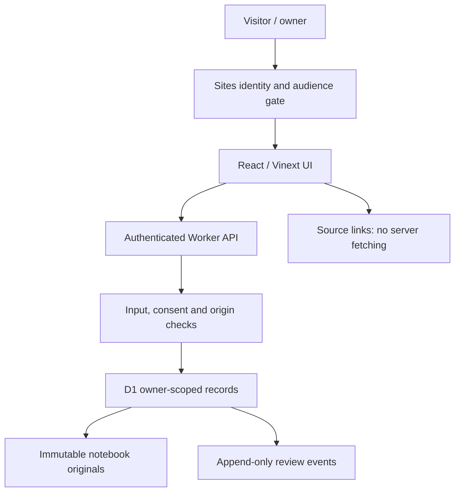

# Strategic Souls: implementation architecture

Release candidate reviewed 7 November 2026 IST. Same project: `appgprj_6ae0ae7364a481919dfb1af2f4fe17f0`. Existing live source before this work: `615835411701ee6916788f18d22bd98e8daea8fc` (version 2).

## Boundaries

- Exactly three primary dashboards. `/workspace` is the authenticated landing; `/` preserves the existing workspace. `/home` is the staged marketing page. Product, methodology, help, trust and pricing routes remain behind the existing owner-only Site audience.
- Sites handles identity and session cookies. Application code never implements a parallel password/OAuth stack or trusts a client-supplied subject. The server obtains the platform's site-specific user ID. External public customer onboarding is NOT verified.
- `app/api/[...path]/route.ts` performs authentication, consent, rate limiting and same-origin JSON enforcement. `lib/notebook.ts` owns bounded notebook and review validation. `lib/notebook-repository.ts` owns parameterized queries and checksum calculation.
- Migration 0003 adds `notebook_souls` and `notebook_events`, plus immutable update triggers and indexes. No original table is reset or dropped. Account deletion explicitly removes the requesting owner's events and originals. Foreign keys also guard dependent records.
- Original payload, ID and creation time are hashed with SHA-256. Event payload, event ID, parent and timestamp are separately hashed. These hashes detect accidental change; they do not provide an independent trusted timestamp or prevent a privileged database operator from replacing both content and hash.
- Notebook saves use an owner-scoped unique semantic digest. Review operations use a request ID; reuse with different payload is rejected. A changed thesis creates a new ID and an owned parent link.
- No network fetching of submitted URLs. Only reference metadata and the author's original interpretation are stored. These are USER_SUPPLIED, REFERENCE_ONLY, and never become verified evidence merely by saving.
- Legacy synthetic Souls remain in their original tables, excluded from active research; exports identify them separately. Local reference download remains a legacy standalone reference, not the new server application.

## Status semantics

PENDING: deadline not passed; no manual review yet. INCONCLUSIVE: deadline passed without independently verified outcome, or a manual supportive/inconclusive review. INVALIDATED: latest user-reported review contradicts the thesis; still explicitly unverified. ARCHIVED: latest archive state is hidden from active research (selectable in the archive). READY/EVALUATED are deliberately not fabricated while no trusted later-observation adapter exists.

## Computational bounds

| Operation | Time | Space | Limit |
|---|---|---|---|
| Notebook validation and hashing | O(E + L + B) | O(E + L + B) | 6 evidence links, 1,000 formula characters, 32 KB body |
| Formula parse | O(L) | O(L) | 160 nodes, depth 24 |
| Formula evaluation | O(V) visited nodes | O(depth + lookback) | 100,000 evaluation budget; lookback ≤500 |
| Quote normalization | O(1) | O(1) | No network or history access |
| CSV parse/dedupe | O(B + N) expected | O(B + N) | 100 KB, 100 rows |
| BSM scenario | O(1) | O(1) | Scalar hypothetical values only |
| Notebook archive read | O(S + E) result processing, indexed owner lookup | O(S + E) | 1,000 Souls / 5,000 events; fail explicitly above cap |
| Current archive UI filtering | O(S × E log E) worst case | O(S + E) | Bounded alpha, not a high-volume history UI |

Public-scale pagination and indexed status projections are deferred. Full account exports explicitly reject over-cap archives instead of silently truncating them. Larger archives require an operator export.
