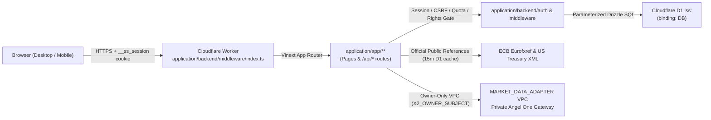

# Strategic Souls Architecture

**Owner:** Global Vertex Vectors (GVV)  
**Production Worker:** `strategic-souls` (`https://strategic-souls.vishnukota20071005.workers.dev/`)

---

## Five-Folder Repository Layout

The Git repository root is organized cleanly into five tracked top-level directories plus a single root `README.md`. The JavaScript/TypeScript/Vinext application root is **`application/`** rather than the Git root.

```text
strategic-souls/
├── .github/                  # GitHub Actions CI + root-layout & secret/artifact invariant checks
├── application/              # Vinext / Next App Router / Cloudflare Worker / Vite JS project root
│   ├── app/                  # Pages, layouts, and API route handlers
│   ├── backend/              # Auth, middleware/security, engines, domain services, Python quant
│   ├── database/             # Executable Drizzle SQLite schemas & D1 repositories
│   ├── frontend/             # Shared workspace shell, feature modules, styles, client helpers
│   ├── public/               # Static assets served at / (GVV logo, fonts, avatars, NASA Earth)
│   ├── scripts/              # Managed CI fixed-path wrapper (scripts/install-pnpm.sh)
│   ├── tests/                # Node unit & integration suites (D1 SQLite + PGlite Postgres)
│   └── tooling/              # App-local build, preview, pnpm install, and verification runners
├── database/                 # Canonical 21 D1 SQL migrations (0000–0020) + Supabase V3 migrations
├── documentation/            # Consolidated architecture, setup, market-data, rights & specs
├── operations/               # Deployment/rollback runbook, operational scripts & concise reports
└── README.md                 # Developer entry point
```

---

## Request Lifecycle & Runtime Flow



1. **Worker Edge Middleware (`application/backend/middleware/index.ts`):** Enforces security headers (`X-Content-Type-Options: nosniff`, `Referrer-Policy`, CSP, HSTS in production), handles Cloudflare Cron Triggers (`* * * * *` durable scan batch worker; `*/2 * * * *` shared history refresh and expired report purge), and dispatches HTTP traffic to Vinext SSR/RSC routes.
2. **Routing (`application/app/`):**
   - Primary UI routes: `/`, `/workspace`, `/home` (Workspace), `/legacy` (Retained owner research workspace), `/signin`, `/product`, `/how-it-works`, `/methodology`, `/pricing`, `/trust`, `/terms`, `/help`, `/asset/[label]`, `/legal/[slug]`.
   - Core APIs: `/api/auth/[...action]`, `/api/release`, `/api/markets/overview`, `/api/markets/public`, `/api/market/*`, `/api/strategy/scan`, `/api/strategy/universe`, `/api/profile`, `/api/community/*`, `/api/x1/*`, `/api/x2/*`, `/api/earth/conflicts`, `/api/calendar/events`, `/api/intelligence`, `/api/media/upload`, `/api/notifications`, `/api/polls`, `/api/search/history`, `/api/compare`, `/api/v3/[...segments]` (optional V3 Supabase API / legal projection).
3. **Domain Engines & Services (`application/backend/`):**
   - **Engines (`backend/engines/`):** Deterministic Soul Scan AST compiler & evaluator (`scan.ts`), portfolio/ledger math (`portfolio.ts`), pattern drawing (`pattern-draw.ts`), chart analytics, probability/backtest helpers, price alerts.
   - **Market Data (`backend/services/market-data/`):** Official ECB FX & US Treasury 15-minute D1 reference cache (`official-references.ts`), 24 ISO 10383 MIC exchange clock & calendar math (`exchanges.ts`, `globe.ts`), shared history & Nifty 500 grant/quota orchestrator (`providers.ts`, `shared-history.ts`, `data-service.ts`), and strictly read-only owner-gated Angel One VPC adapter (`angelone/*`).
   - **Optional Python Quant (`backend/quant/`):** Offline/local vectorized Parquet/DuckDB quantitative evaluation engine (`souls_quant`) tested independently via `pytest`.
4. **Database Split (`application/database/` vs `database/`):**
   - Runtime TypeScript Drizzle tables and query helpers live in `application/database/schemas/` and `application/database/queries/`.
   - Authoritative SQL migration history (`0000_bent_reptil.sql`–`0020_official_reference_cache.sql` + `meta/`) lives in top-level [`database/migrations/`](../database/migrations/) alongside optional local V3 PostgreSQL migrations in [`database/supabase/`](../database/supabase/).

---

## Cloudflare Worker & Storage Bindings

Defined in [`application/vite.config.ts`](../application/vite.config.ts) and emitted verbatim into `application/dist/server/wrangler.json` on production build:

| Binding / Setting | Configured Value | Purpose |
| --- | --- | --- |
| **Worker Name** | `strategic-souls` | Existing production Worker (`nodejs_compat`, `2026-05-15`) |
| **Worker Entry** | `./backend/middleware/index.ts` | Middleware + Cron handler + Vinext delegation (relative to `application/`) |
| **D1 Binding (`DB`)** | `ss` (`1cda2b05-6b99-4d04-896f-b3542ad2ce7f`) | Primary relational store (append-only triggers on immutable research records) |
| **VPC Binding** | `MARKET_DATA_ADAPTER` (`01a2095b-f466-7c90-a813-4fad03735504`) | Private owner-only loopback broker adapter tunnel |
| **Version Metadata** | `CF_VERSION_METADATA` | Build/version observability for `/api/release` |
| **Vars** | `ENABLE_PRIVATE_BROKER_DATA="true"`, `INDIA_API_HOST="stock.indianapi.in"` | Non-secret gateway & API host defaults |
| **Cron Triggers** | `["* * * * *", "*/2 * * * *"]` | Durable batch scan execution (`* * * * *`) & shared-history ingestion/purge (`*/2 * * * *`) |

---

## Design System & Visual Invariants

Defined in [`application/frontend/styles/globals.css`](../application/frontend/styles/globals.css) and verified by `application/tests/unit/x1-palette.test.mjs`, `x1-motion.test.mjs`, and `x1-globe.test.mjs`:

- **Canonical Neutral Surfaces & Text:** `--x1-bg` (`#070809`), `--x1-surface-1` (`#101215`), `--x1-surface-2` (`#191C20`), `--x1-surface-3` (`#23272D`), `--x1-divider` (`#3B424C`), `--x1-divider-strong` (`#677382`), `--x1-text-primary` (`#E8EDF2`), `--x1-text-secondary` (`#CAD3DC`), `--x1-text-tertiary` (`#B9C3CE`), `--x1-text-muted` (`#A7B1BC`).
- **Heading-Only Accent:** `--x1-title-blue` (`#76C0FF`) and `--x1-title-blue-alt` (`#94D0FF`) are strictly restricted to real `h1`/`h2`/`h3` elements.
- **Self-Hosted Fonts (`application/public/fonts/`):** `Space Grotesk` (headings), `Inter` (body/controls), `IBM Plex Mono` (tabular numbers/formulas) with SIL OFL license files alongside the `.woff2` binaries.
- **3D Earth & 2D Regional View:** Custom WebGL2/WebGL1 NASA Blue Marble + Black Marble shader (`globe-canvas.tsx`) plus dynamic-imported MapLibre view (`regional-map.tsx`). All NASA texture SHA-256 checksums and `/public/gvv-approved.jpg` checksums are invariant-tested.
- **Motion Policy:** One-shot `EclipseIntro` plays at most once per session (`<= 1050ms`), is immediately skippable, non-blocking (`pointer-events: none` container), and honors `prefers-reduced-motion: reduce`.
