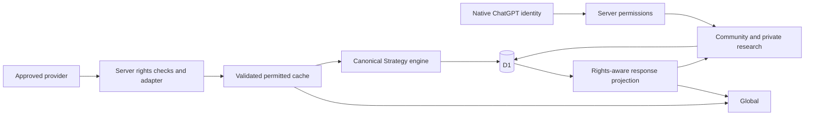

> Historical export guide, 18 November 2026. Use the [current README](../../../../README.md) for commands and locations.

# Strategic Souls


**Research into evidence.**

A private financial-research workspace developed by **Global Vertex Vectors (GVV)**. This is the internal source workspace for the founder and a future second developer. Strategic Souls connects source-aware market context, explicit hypotheses, persistent evidence and permissioned collaboration. It is an educational and research product—not a broker, an execution system or a promise of profitable signals.

| Status — 18 November 2026 | Current reality |
|---|---|
| Foundation | ChatGPT Site version **12**, source `5b02f5b63cd469f80ba05bc62f4217bd5ddcd697` |
| Export | Full application source; 12 UI files relocated into functional folders; canonical shared engines/authentication retained |
| Working | Official daily FX/yields, watchlists, manual accounting, named scans/drafts/history, sourced charts, private community implementation |
| Data dependencies | Commercial tokens, licences, mappings and certified historical vintages are absent |
| Probability | **INSUFFICIENT EVIDENCE**; unsupported numerical confidence remains suppressed |
| Hosting | Original owner-private ChatGPT Site; GitHub push does **not** deploy it |
| Evidence | Exact final export checks are in [SOURCE_PROVENANCE.json](../../../../SOURCE_PROVENANCE.json) |

## 1. What is Strategic Souls?

Research often begins with a chart and ends with an opinion that cannot be reproduced. Strategic Souls gives a hypothesis a name, rules, source context and a durable record. Researchers can distinguish unavailable inputs from a failed condition, return to an original execution and record what later challenged the idea.

**Observe in Global → define in Strategy → run a Soul Scan → compare History and reviewed Graveyard evidence → collaborate in Community → review matured outcomes.**

A **Soul** is a method or research record, not an automatically validated recommendation. A **Body** is a research profile. The **Graveyard** contains reviewed/retired research; its selected negative cases cannot supply a success denominator by themselves.

## 2. The long-term vision

GVV aims to build an accessible, professional research ecosystem: institutional-style context, user-designed systematic research, transparent uncertainty, persistent research memory and a high-signal network.

The ambition is to reduce the gap between a beginner and an experienced analyst through intuitive workflows while keeping the mathematics, provenance and limitations visible. Trustworthy connectors, reproducible analytics and permissioned teamwork should make the workspace more useful over time. Explanations should clarify evidence rather than hide uncertainty behind an impressive score.

This is a direction for a sustainable financial-research product, not a claim that all data, validation or business capabilities are already available. X3/X4 ideas below are not scheduled promises.

## 3. Three dashboards: working versus gated

| Dashboard | Working implementation | Partial, blocked or absent |
|---|---|---|
| **Global** | Official ECB daily histories/cross rates and Treasury yields; watchlists; manual portfolio transactions/accounting; asset search/charts/private layouts; historical Earth globe and exchange directory | NSE/BSE/MCX and global-index identities are not connected quotes. Commercial OHLC/statements/news require keys, exact mappings and rights. Live ticks, options chains, depth-based volume profiles and licensed sector heatmaps are absent |
| **Strategy** | Named/described scans; Simple ALL/ANY/NOT and canonical Advanced DSL; preflight/UNKNOWN policy; versioned drafts; immutable execution/history; Graveyard reviews; Radar rule starters; Formula Lab; tested outcome/evidence/backtest algorithms | Metrics require real inputs. Current sources do not certify adjusted PIT vintages, independent cohorts or OOS calibration. Production replay/backtest is DATA UNAVAILABLE and forward probability INSUFFICIENT EVIDENCE. Cross-user model training is disabled |
| **Community** | Bodies, opt-in discovery, message requests/accept/reply, blocks/mutes/hide/report, bookmarks/notifications, group roles/invitations/Souls/revisions, Supers/comments/discussions | Two independent **local test identities** verified messaging. Production remains owner-only; hosted multi-person onboarding is unverified. Sharing does not expose private portfolios or grant training consent |

Missing/unentitled/stale data stays null/UNKNOWN. Stored observations and derived results have separate display grants; expiry/revocation can produce WITHHELD responses without rewriting lawful immutable snapshots. No synthetic fixture becomes market evidence.

The older notebook and labelled synthetic archive remain at `/legacy`. The historical `/api/release` endpoint still describes X1; identify this export using SOURCE_PROVENANCE and native Sites version history.

## 4. Actual code map

```text
strategic-souls/
├── global/               dashboard.tsx, asset-terminal.tsx, globe-canvas.tsx,
│                         data-control.tsx, data.css
├── strategy/             workspace.tsx, controls.tsx, formula-lab.tsx, research.css
├── community/            dashboard.tsx, social-workspace.tsx, social.css
├── public/               GVV image, NASA textures, OFL fonts, icons/download assets
├── db/                   schema.ts, x2-data.ts, x2-social.ts and existing schema
├── app/                  framework layout/routes, API handlers, legacy entrypoint
├── lib/                  shared security, persistence and canonical X1/X2 engines
├── components/           shared shell/search/dialogs, legacy/gated V3 components
├── drizzle/              seven chronological SQLite migrations + metadata
├── worker/               Worker request/security boundary
├── scripts/              existing build/Sites tooling and local-preview.mjs
├── tests/                existing maths/API/security/regression suites
├── docs/                 retained architecture/history; generated logs omitted
├── quant/                optional Python research worker/tests
├── supabase/             optional gated V3 Auth/Postgres source
├── hooks/                existing shared UI utilities
├── vendor/               licensed CSS source/notices
├── examples/             labelled synthetic examples
├── .openai/hosting.json  original Site identity and DB binding
├── .github/workflows/    existing checks; no Site auto-deploy workflow
├── README.md / AGENTS.md / SOURCE_PROVENANCE.json
├── .env.example / .gitignore / package.json
└── pnpm-lock.yaml        sole Node lockfile
```

The five primary functional folders contain real code. Framework-required `app/` and `worker/`, shared `lib/`, existing tests/docs and the consumed `drizzle/` chronology remain. Optional V3/quant source is retained without claiming that its services are active. No new `src/` or documentation framework was introduced.



| Change | Start here |
|---|---|
| Shell/navigation/search | [components/x1/workspace.tsx](../../../../frontend/components/workspace/workspace.tsx), [components/x2/universal-search.tsx](../../../../frontend/components/workspace/universal-search.tsx) |
| Global/charts | [global/dashboard.tsx](../../../../frontend/features/global/dashboard.tsx), [global/asset-terminal.tsx](../../../../frontend/features/global/asset-terminal.tsx) |
| Rule UI | [strategy/workspace.tsx](../../../../frontend/features/strategy/workspace.tsx), [strategy/controls.tsx](../../../../frontend/features/strategy/controls.tsx) |
| Canonical parser/evaluator | [lib/x1/scan.ts](../../../../backend/engines/scan.ts); never copy it into a dashboard |
| Evidence/outcomes/backtest | [lib/x2/research.ts](../../../../backend/services/research/research.ts), [lib/x2/backtest.ts](../../../../backend/engines/backtest.ts) |
| Providers/rights | [lib/x2/data-service.ts](../../../../backend/services/market-data/data-service.ts), [lib/x2/providers.ts](../../../../backend/services/market-data/providers.ts), [lib/x2/scan-projection.ts](../../../../backend/services/research/scan-projection.ts) |
| Community/ACLs | [community/social-workspace.tsx](../../../../frontend/features/community/social-workspace.tsx), [lib/x2/social.ts](../../../../backend/services/community/social.ts), [lib/x1/community.ts](../../../../backend/services/community/community.ts) |
| API/identity/persistence | [app/api](../../../../app/api), [lib/security.ts](../../../../backend/middleware/security.ts), [lib/repository.ts](../../../../database/queries/repository.ts), [worker/index.ts](../../../../backend/middleware/index.ts) |
| Schema/migrations | [db/schema.ts](../../../../database/schemas/schema.ts), [drizzle](../../../../drizzle), [drizzle.config.ts](../../../../drizzle.config.ts) |

## 5. Requirements and beginner quick start

Tested: **Windows, Node 22.16.0, pnpm 11.25.0**. Locked stack: React 19.2.9, Next 16.4.5, Vinext 1.0.0-beta.5, Vite 8.1.6, TypeScript 5.9.3, Wrangler 4.92.0. Install Git and the tested runtime/package manager. Use a new developer directory, not the production Site checkout.

```powershell
git clone https://github.com/GVVKOTA/strategic-souls.git
cd strategic-souls
corepack enable
corepack prepare pnpm@11.25.0 --activate
pnpm install --frozen-lockfile
Copy-Item .env.example .env
npm run verify:x2
npm run build
npm run local:setup
npm run local:serve
```

Open **http://127.0.0.1:5173** after the Worker starts. **Ctrl+C** stops the runner and its owned Worker. On macOS/Linux the template-copy command is `cp .env.example .env`; those platforms were not tested in this session.

`local:setup` applies all seven migrations with explicit **`--local`** into ignored `.wrangler/local-preview`. No account, message or fake market row is seeded. `local:serve` runs the actual compiled Worker at loopback port 8787 behind a loopback-only adapter on 5173. The adapter supplies a clearly fictional development identity, strips caller identities/cookies, rejects cross-origin writes and copies no production sessions or records. Complete local onboarding yourself. Production authentication is unchanged; this developer adapter is never imported by the production Worker.

For core X2, `.env` is optional and the compiled local runner does not load the root `.env`. The copied template documents actual variable names, including the separately gated V3 stack. The runner supplies its own fictional `X2_OWNER_SUBJECT`. If you have authorized development provider credentials, put only the required provider keys in ignored `.sites-runtime/.dev.vars`, alongside the generated Wrangler configuration; never put secret values in config `vars`. This follows [Cloudflare's local-secret configuration](https://developers.cloudflare.com/workers/local-development/environment-variables/). No provider credentials are needed for core onboarding, and a key alone does not authorize data use.

### Start commands and troubleshooting

- **`npm run local:serve`** is the compiled-Worker Windows path. Build/setup first, then rebuild/restart after code changes; it has no HMR.
- `npm run dev` retains the original Vite/Vinext flow. Here it reproduces an upstream `recentlyCreatedOwnerStacks` startup error and is not claimed as passing.
- `npm start` previews the compiled Worker directly on 8787 without the developer identity adapter. Private operations need platform identity; a rendered shell alone is not an authenticated smoke test.

| Problem | Action |
|---|---|
| Missing dependencies | `pnpm install --frozen-lockfile`; do not generate another lockfile |
| Empty offline metadata cache | First install needs registry access; use the ordinary frozen install |
| Node/SQLite/type-stripping error | Reproduce on Node 22.16.0 before changing app code |
| Missing build/table | Run `npm run build`, then `npm run local:setup`; never substitute `--remote` |
| Port in use | Stop your own preview; do not kill an unrelated process |
| 401/403/consent required | Use the local adapter and complete onboarding; hosted identity/consent are separate |
| Provider unavailable | Check token, licence, mappings, freshness and required history; missing inputs are not zero |
| V3/quant unavailable | They are optional/gated; their source is not proof of active services |

## 6. Data providers and safe configuration

No commercial credential/licence is included. Implemented adapters: **TrueData historical EOD**, **EODHD EOD/statements/news**, plus existing official ECB/Treasury references. Exact contracts/limits: [X2_DATA_SETUP.md](../../setup/X2_DATA_SETUP.md). Vendor-confirmed identities are mandatory; MCX needs a real dated contract, expiry, currency and lot/tick/multiplier metadata. A generic seed is not coverage.

| Variable/binding | Purpose |
|---|---|
| `DB` | Managed D1 binding, locally emulated; not a browser `.env` value |
| `X2_OWNER_SUBJECT` | Exact hosted native owner subject in server settings; fictional local value supplied by the runner |
| `X2_TRUEDATA_BEARER_TOKEN` | Optional server-only historical bearer token; no automatic login refresh claimed |
| `X2_EODHD_API_TOKEN` | Optional server-only commercial token |
| `SUPABASE_*`, `V3_*`, `QUANT_WORKER_ACCESS_TOKEN` | Retained optional/gated services; not required for core X2 local mode |

For production, use the Site's runtime secret manager. Never put real values in Git, screenshots, CI logs, issues or frontend metadata. A key is separate from display, derived-display, non-display scans, caching, storage and redistribution rights; expiry/revocation matters. The Data Control Center never accepts arbitrary provider keys as frontend metadata.

LIVE requires verified streaming/freshness evidence; DELAYED means source-declared delay; LAST CLOSE/EOD is a completed published observation; HISTORICAL is older data; STALE fails freshness; NOT ENTITLED lacks rights; UNAVAILABLE lacks verified inputs. Current official references are daily observations, not executable quotes. Do not invent source times, volume, zeroes or LIVE labels.

The INR 3,000 reserve is a constraint, not purchase authorization or proof of licence affordability. No payments, brokerage execution or active paid subscription is provided. X2 adds no crypto subsystem; older labelled references remain isolated in legacy source.

## 7. A practical two-person workflow

The founder owns product decisions, repository ownership and release approval. The friend works on scoped feature branches and reviewed PRs. This is a team agreement, not a claim that the current GitHub plan enforces it.

1. Start clean: `git switch main`, then `git pull --ff-only`.
2. Agree on task/file boundaries; create `git switch -c feature/global-charts` (or `fix/strategy-scan`, `feature/community-messages`).
3. Make one coherent change. Reuse shared algorithms and add meaningful behavioral tests.
4. Run `npm run verify:x2` and `npm run build`; review sensitive maths, permission and migration changes carefully.
5. Inspect `git diff`, stage exact files and commit clearly. Never add `.env`, local DBs, exports or private screenshots.
6. Push the branch, open a PR and explain the problem, behavior, tests and limitations.
7. Review together, resolve conflicts deliberately, merge after checks and pull `main` before the next task.

A **commit** records a checkpoint. A **branch** is an independent line of work. A **pull request** requests review before combining changes. A **merge** combines accepted work. A **conflict** needs human reconciliation; it is not permission to overwrite another person's code or force-push.

### Inviting the friend

No invitation is sent by this export. After the exact username is supplied and the owner authorizes it, use repository **Settings → Collaborators → Add people**, select the exact account and confirm. [GitHub's invitation guide](https://docs.github.com/en/repositories/managing-your-repositorys-settings-and-features/repository-access-and-collaboration/inviting-collaborators-to-a-personal-repository) was checked on the update date.

Personal private-repository collaborators have write access, not a read-only role, and may retain local clones after removal. See [GitHub's permission guide](https://docs.github.com/en/repositories/managing-your-repositorys-settings-and-features/repository-access-and-collaboration/permission-levels-for-a-personal-account-repository). Use individual identities/development credentials; do not share the founder's production session or tokens. Revisit access if the partnership changes.

## 8. Tests, quality and security

```powershell
npm run typecheck
npm run lint:app
npm test
npm run verify:x2
npm run build
```

`verify:x2` checks types, all application areas and the retained Node suites, with logs under ignored `.sites-runtime/x2-checks`. Final Windows export verification: **244 tests passed, zero failures/skips**, typecheck/lint and production build passed. Five compiled-Worker HTTP/security checks passed; see SOURCE_PROVENANCE.json for commands and limits. No coverage percentage or independent financial audit is claimed.

Tests cover rules/indicator/portfolio/outcome arithmetic, calibration suppression, known-at/leakage constraints, provider rights, snapshots/exports, duplicate writes/concurrency, social/group ACLs, blocking, private layouts, account-erasure boundaries, palette and globe geometry. SQLite/VM fixtures are explicitly synthetic and are not production users or market evidence. Add focused tests near new modules or in the existing critical backend suites; never weaken assertions to manufacture green results.

The retained `.github/workflows/verify.yml` checks pushes/PRs; remote Actions success is separate evidence. `verify-v3.yml` is manual and requires its optional Docker/Supabase/quant setup. Neither deploys the Site. No secret-dependent external CI integration is added.

Preserve server-side native identity/consent, ownership/participant/group checks, bounded inputs, rate limits, request-key idempotency and additive migrations. DMs are participant-scoped server records, not E2EE. Current display grants govern stored research responses. Source/security scans reduce risk but cannot prove absence of every secret or defect.

X2 documented one unpatched high picomatch advisory in development/build tooling and two moderate findings: [X2_DEPENDENCY_REVIEW.md](X2_DEPENDENCY_REVIEW.md). Do not claim a clean dependency audit or invent an unavailable patch. Device accessibility, forced WebGL loss, field INP, commercial credentials and real predictive accuracy are not certified by fixtures.

## 9. Deployment and backups

**GitHub push ≠ Site deployment.** No automatic GitHub→Sites link was verified/enabled. This export changes neither hosted code nor database, environment, audience or URL.

[.openai/hosting.json](../../../../.openai/hosting.json) retains the original project `appgprj_6ae0ae7364a481919dfb1af2f4fe17f0`, D1 binding `DB`, and no configured R2 bucket. Original URL: https://strategic-souls-gvv.vishnukota20071005.chatgpt.site/ .

For a later approved release, Codex with Sites must re-read current identity/version/source/access, open the original source with its official helper, reconcile reviewed GitHub changes into that checkout, privately back up current data, check/build, push/package the exact Site source and use the supported native deployment operation. Retain IDs and verify original URL/access, migrations and preserved records. Record both GitHub and resulting Sites SHAs; reconciliation can make them different. If tools are unavailable, prepare a patch and report the block. Never register a replacement Site or assume a push published it.

Git/ZIP backs up **code**, not hosted **rows**, secrets, sessions, uploaded files or vendor licences. Schema is not a production database backup. Logical data backups stay outside Git with separate hashes/restore checks. No production data export is included here.

Application rollback uses a verified previous saved Site version after preserving newer writes. Additive tables may remain. Code rollback does not undo destructive SQL or restore rows. Never delete migration history or reverse production data without a reviewed recovery plan and owner authorization.

## 10. Future roadmap — vision, not commitments

| Horizon | Direction and user benefit |
|---|---|
| **Now / X2 foundation** | Fix critical bugs, reliable named scans, permitted provider adapters, reproducible evidence and collaboration. Actual activation/calibration remain gated |
| **Next / X3 possibilities** | Stronger sector/peer comparisons, advanced charts/routing, deeper replay and flexible collaboration when evidence and budget justify them—better comparisons with fewer manual steps |
| **Later / X4+ possibilities** | Broader authorized global datasets, cohort analytics, expanded workflows and carefully reviewed AI explanations that clarify evidence |

A possible sustainable model combines basic/free research with paid advanced capabilities only after demand, compliance, pricing and actual costs are validated. No unapproved subscription or return promise is active. AI may explain evidence; it cannot replace licensed inputs or validated mathematics.

## 11. Contributing, governance and ownership

This is a **private proprietary application**, not an open-source invitation. No application open-source licence is granted by this export. Existing third-party notices apply to their own material; do not invent legal registrations or claim ownership of NASA/vendor work.

Agree on a focused task before editing shared files. Bug reports need trigger, expected/actual behavior, source version and sanitized reproduction steps. Ask for help with a small reproducible example and concrete blockers, never an account export/token. Permission logic, probability, provider routing and migrations deserve extra review.

Use small commits and behavioral release notes. A dated **export-checkpoint** tag describes this source delivery; an incomplete product must not be labelled `x2-stable`. Do not overwrite tags, force-push others' history or publish public releases without approval.

This repo starts with a sanitized import: original history contained personal commit-email metadata and historical generated evidence. The full history stays privately outside GitHub. The original deployed SHA plus relocation manifest preserve provenance; working server/auth/database logic was not replaced with demo stubs.

The approved GVV JPEG is unchanged. NASA textures retain attribution/no-endorsement and historical-composite disclosures in [GLOBE_ASSET_RIGHTS_X1.md](../../data-rights/GLOBE_ASSET_RIGHTS_X1.md) and [public/data/earth-assets.json](../../../../public/data/earth-assets.json). Fonts retain OFL notices under [public/fonts](../../../../public/fonts); vendored tooling/CSS retains its notices in `scripts/vite` and `vendor`.

## 12. Minimum release checklist

- Review the PR, meaningful permission/maths regressions, full checks and actual build.
- Inspect intended files/history for secrets, user records, false claims and generated artifacts.
- Verify provider rights, exact instrument contracts, units, timestamps and freshness.
- Review migration/recovery implications; privately back up current hosted data.
- Get founder release approval; use the verified original Sites path and preserve restricted access.
- Smoke-test original URL/owner journey, compare preserved records and record both SHAs, saved version and deployment result.

Research/education is not personal financial advice or guaranteed performance. A precise unavailable state or insufficient-evidence result can be the correct outcome.
