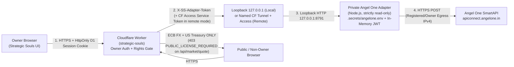

# Strategic Souls — Market-Data Architecture & Decision Record

**Version:** X3.1 | **Checked Date:** 2026-11-21 | **Target Timezone:** `Asia/Kolkata` (IST)

---

## 1. Architecture Decision Record (ADR-X3.1)

### Selected Architecture: **PATH B — Private Loopback Broker Adapter + Cloudflare Worker Secure Gateway**

### Why PATH B Was Selected
1. **Zero Broker Credentials on Shared Edge Infrastructure:** Angel One `ANGELONE_API_KEY`, `ANGELONE_CLIENT_ID`, `ANGELONE_MPIN`, and optional `ANGELONE_TOTP_SECRET` never leave the private adapter host (`.secrets/angelone.env`). The Cloudflare Worker holds **only** `X2_OWNER_SUBJECT`, `MARKET_DATA_ADAPTER_URL`, `MARKET_ADAPTER_AUTH_TOKEN`, and optional Cloudflare Access service tokens.
2. **Egress vs. Ingress Separation:** Cloudflare Workers run on shared dynamic edge IPs and cannot present a dedicated static IPv4 registered to one Angel One trading client. Separating the broker adapter onto the owner's controlled egress host cleanly honors Angel One's static-IP architecture without spoofing or bypassing IP rules.
3. **Zero Third-Party Broker SDK Bloat:** The adapter uses pure Web-Standard `fetch` + Web Crypto RFC 6238 TOTP directly against Angel One's verified REST endpoints, avoiding legacy Node SDK dependencies, runtime incompatibilities, and exposed order-execution methods.
4. **Resilient Degradation:** Because the Cloudflare Worker degrades gracefully on `ADAPTER_OFFLINE` (`503`), the main Strategic Souls site (`Global`, `Strategy`, `Community`, 3D Earth, ECB FX, US Treasury) stays 100% online even when the owner's laptop sleeps.

### Discarded Alternatives
- **PATH A (Direct Angel One Calls from Cloudflare Worker):** Rejected because (a) Cloudflare Workers lack a dedicated static outbound IPv4 registered to the client, and (b) placing long-lived Angel One MPIN/TOTP secrets on shared frontend/edge hosting violates least-privilege credential isolation.
- **PATH C (Dedicated Always-On Paid Static-IPv4 VPS):** Deferred to avoid unauthorized recurring infrastructure spend. The exact same `adapter-server.ts` container/process can move to an approved low-cost static-IPv4 VPS later with zero code changes simply by updating `MARKET_DATA_ADAPTER_URL`.
- **Unauthenticated Quick Tunnel:** Permanently rejected for production; remote production tunnel traffic requires a Named Cloudflare Tunnel + Cloudflare Access service tokens + `X-SS-Adapter-Token`.

---

## 2. Egress vs. Ingress Network Truth

| Traffic Direction | Network Path | IP / Auth Responsibility |
| --- | --- | --- |
| **Ingress** (Cloudflare Worker -> Adapter) | Local `127.0.0.1:8791` OR Named Cloudflare Tunnel (`https://...`) | Authenticated via `X-SS-Adapter-Token` (constant-time) + Cloudflare Access service tokens. **Tunnel handles inbound connectivity only.** |
| **Egress** (Adapter -> Angel One SmartAPI) | Owner host outbound IPv4 -> `https://apiconnect.angelone.in` | Governed by owner ISP/VPS IPv4 (`49.43.221.217` observed on 2026-11-21 via Reliance Jio ASN 55836 — residential broadband, not guaranteed static unless ISP static IP is contracted). |

---

## 3. Module Architecture (Strictly Read-Only)

All new broker modules live inside the existing `backend/services/market-data/angelone/` ownership area:

| Module | Runtime | Responsibility |
| --- | --- | --- |
| `types.ts` | Shared | Provider-neutral & normalized quote, candle, session, health, and error schemas. |
| `redact.ts` | Shared | Secret/JWT/Client-ID redaction + fail-closed `parseAdapterConfig` and `parseGatewayConfig`. |
| `calendar.ts` | Shared | Verified 2026 NSE, BSE, and MCX holiday & session calendar (IST), plus `DataQualityState` classifier. |
| `totp.ts` | Shared | Zero-dependency RFC 6238 SHA-1 TOTP using Web Crypto. |
| `normalizer.ts` | Shared | Verified rupee vs. paise normalization (`tick_size / 100`), epoch-zero index trade-time fallback, zero-denominator protection, cash-equity OI stripping, MCX contract metadata. |
| `instrument-master.ts` | Shared | Compound identity (`exchange:segment:symbol:token`) resolver from official `OpenAPIScripMaster.json`, rejecting expired MCX contracts. |
| `rate-limiter.ts` | Shared | Bounded rolling quotas (quote 1 req/s & 45/min; candles 3 req/s & 90/min), single-flight deduplication, short TTL cache (5s quotes / 60s candles), transient-only backoff, circuit breaker. |
| `auth-session.ts` | Adapter | In-memory Angel One session lifecycle (`loginByPassword`, one-shot `generateTokens` refresh, read-only `getProfile` exchange-code extraction with zero PII retained). |
| `provider.ts` | Adapter | Read-only NSE/BSE/MCX batch quote & isolated historical OHLCV orchestration. Zero order/trading methods. |
| `adapter-server.ts` | Node (`127.0.0.1`) | Loopback-only HTTP server enforcing constant-time `X-SS-Adapter-Token` on `/internal/*`. |
| `gateway.ts` | Cloudflare Worker | Owner auth + compliance flag gate (`ENABLE_PRIVATE_BROKER_DATA`, `ENABLE_PUBLIC_EXCHANGE_QUOTES=false`, `MARKET_DATA_DEMO_MODE=false`) bridging Worker API routes to the private adapter. |

---

## 4. Session Lifecycle & Failure Handling

1. **Login (`loginByPassword`):** Uses API Key (`X-PrivateKey`), Trading Client ID, MPIN, and fresh 6-digit TOTP (manual TOTP preferred; local opt-in seed supported). Tokens (`jwtToken`, `refreshToken`, `feedToken`) live **only in process RAM** and expire conservatively before IST midnight (`nextIstMidnightMs`).
2. **Refresh (`generateTokens`):** On HTTP `401` or Angel One `AG8001`/`AG8002`/`AB1010`, the provider attempts **one** official refresh-token renewal. Refresh inherits daily session validity and never pretends to replace daily TOTP MFA.
3. **No Retry Storms:** Invalid TOTP (`AB1050`), invalid MPIN, `403` static-IP blocks, and `429` rate limits fail immediately with structured error codes and cooldowns — never looping.
4. **Independent Endpoints:** Historical candles (`/api/market/candles`) run independently of quotes (`/api/market/quote`); historical throttling never marks quotes unavailable.
5. **Streaming Policy:** SmartWebSocketV2 is intentionally deferred for X3.1 because bounded, deduplicated REST batching (`POST /market/v1/quote/` supporting up to 20 instruments per call) satisfies private owner research without maintaining persistent WebSocket state or risking socket ban limits.
