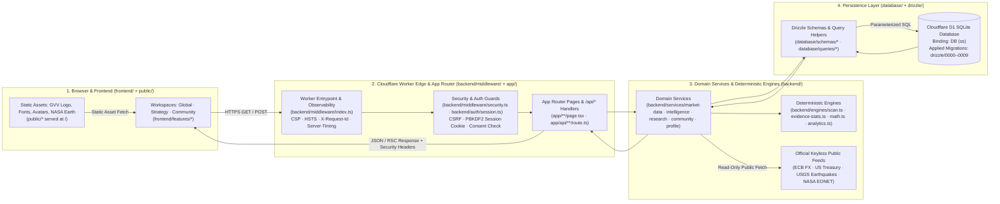

# Strategic Souls — Repository Map & Request Lifecycle (`X5.5`)

This document maps every directory and root file in `GVVKOTA/strategic-souls`, explains the five primary ownership areas alongside the mandatory framework/GitHub root exceptions, and diagrams the end-to-end request lifecycle.

---

## 1. End-to-End Request Lifecycle (`Frontend → API → Service/Engine → Database → Response`)

---

## 2. Directory-Specific Path Ownership Matrix

### A. Five Primary Ownership Areas (Domain Source, Assets, Docs, Tooling & Archive)

| Ownership Area | Directory / Subpath | What It Owns | Key Entrypoints | Area Guide |
| --- | --- | --- | --- | --- |
| **1. Frontend** | `frontend/features/global/` | 4-block `Strategic Dashboard`, 9-card market grid, `1.0×`–`5.0×` 3D `Strategic Globe`, `Economic Calendar`, `Market Intelligence`, `Market Vox`, `Heatmap`, `Portfolio Allocation`, `Asset Terminal` | `dashboard.tsx`, `market-grid.tsx`, `strategic-globe.tsx`, `globe-canvas.tsx`, `economic-calendar.tsx`, `daily-pulse.tsx` | [`frontend/README.md`](../../frontend/README.md) |
| **1. Frontend** | `frontend/features/strategy/` | `[Soul Scan \| Formula Lab]`, 50 Classic presets, Advanced (`Discover`/`Build`/`Draw`), blank-by-default Soul name, compact results, standalone `GRAVEYARD` heading, SVG Evidence charts | `workspace.tsx`, `controls.tsx`, `evidence-charts.tsx`, `formula-lab.tsx`, `draw-canvas.tsx`, `scanner-x54.css` | [`frontend/README.md`](../../frontend/README.md) |
| **1. Frontend** | `frontend/features/community/` | `Soul Network` (`Soul Feed \| Chats \| Rooms`), canonical `PublicProfileSheet`, modular Telegram-like `messenger/`, Room discussions & pinned research | `research-network-shell.tsx`, `public-profile-sheet.tsx`, `social-workspace.tsx`, `dashboard.tsx`, `messenger/*` | [`frontend/README.md`](../../frontend/README.md) |
| **1. Frontend** | `frontend/features/account/` & `auth/` | Profile settings, 50-avatar & 8-banner selector, QR card, standalone D1 email/password & optional Google OAuth sign-in | `settings-view.tsx`, `account-quick-panel.tsx`, `avatar-studio.tsx`, `auth-panel.tsx` | [`frontend/README.md`](../../frontend/README.md) |
| **1. Frontend** | `frontend/components/`, `hooks/`, `lib/`, `styles/` | Shared workspace shell, locked 4-item Global menu, `EclipseIntro`, Universal Search, shadcn/ui primitives, QR encoder, canonical 6-color CSS tokens (`globals.css`, `x51.css`) | `components/workspace/workspace.tsx`, `global-menu.ts`, `styles/globals.css`, `styles/x51.css` | [`frontend/README.md`](../../frontend/README.md) |
| **2. Backend** | `backend/auth/` & `backend/middleware/` | Cloudflare Worker entrypoint, CSP/HSTS/cache headers, `X-Request-Id`/`Server-Timing`/`ss_api_signal` observability, CSRF, PBKDF2-SHA256 D1 session auth, optional Google OAuth | `middleware/index.ts`, `middleware/security.ts`, `auth/session.ts` | [`backend/README.md`](../../backend/README.md) |
| **2. Backend** | `backend/engines/` | Canonical Soul Scan AST/DSL (`scan.ts`), Wilson 95% CI & Brier stats (`evidence-stats.ts`), next-open backtest (`backtest.ts`), Formula Lab BSM/IV/CAGR/XIRR (`math.ts`), correlation & portfolio math (`analytics.ts`, `portfolio.ts`) | `scan.ts`, `evidence-stats.ts`, `backtest.ts`, `math.ts`, `analytics.ts` | [`backend/README.md`](../../backend/README.md) |
| **2. Backend** | `backend/services/` | Market-data providers & validation/entitlement contracts (`providers.ts`), ECB/Treasury, 9-card grid, Calendar, Market Vox, 3D Globe math, USGS/NASA hazards, 50 presets, scan quotas, Soul Network, DMs, Rooms, profiles | `market-data/providers.ts`, `market-data/globe.ts`, `research/research.ts`, `community/research-network.ts`, `community/social.ts` | [`backend/README.md`](../../backend/README.md) |
| **2. Backend** | `backend/integrations/` & `backend/quant/` | Allowlisted TradingView widget helpers and optional Python DuckDB/NumPy quant package (`souls-quant`, 29 pytest tests) | `integrations/tradingview.ts`, `quant/pyproject.toml` | [`backend/README.md`](../../backend/README.md) |
| **3. Database** | `database/schemas/` & `database/queries/` | Cloudflare D1 Drizzle ORM SQLite table schemas (`accounts`, `auth_*`, `x1_*`, `x2_*`, `x51_*`, `x52_*`) and parameterized query/retention helpers | `schemas/index.ts`, `schemas/schema.ts`, `queries/repository.ts` | [`database/README.md`](../../database/README.md) |
| **4. Public Assets** | `public/` | Static assets served at `/`: approved GVV logo (`gvv-approved.jpg`), favicons, self-hosted WOFF2 fonts + SIL OFL licenses (`fonts/`), 50 SVG avatars (`avatars/`), NASA Earth textures + SHA-256 manifest (`data/`), offline reference docs (`downloads/`) | `gvv-approved.jpg`, `data/earth-assets.json`, `fonts/fonts.css`, `avatars/a01.svg` | [`public/README.md`](../../public/README.md) |
| **5. Operations & Archive** | `operations/docs/`, `scripts/`, `reports/`, `examples/`, `archive/` | Active runbooks & release audits (`docs/`), build/preview/test/secret-scan/backup scripts (`scripts/`), reorganization manifest (`reports/`), D1 examples (`examples/`), and the single consolidated historical archive (`archive/`) | `docs/README.md`, `scripts/check-x2-release.mjs`, `scripts/local-preview.mjs`, `archive/README.md` | [`operations/README.md`](../README.md) · [`operations/archive/README.md`](../archive/README.md) |

---

### B. Mandatory Framework, CI & Tooling Root Exceptions (Why Physical 5-Only Root Is Blocked)

Under zero-application-code-change, zero-config-change, and zero-regression constraints, the following paths **must** remain at the repository root:

| Root Path | Category | Concrete Technical Contract Requiring Root Location | Verification Evidence |
| --- | --- | --- | --- |
| `.github/workflows/*.yml` | Native CI | GitHub Actions discovers workflows exclusively at `<root>/.github/workflows/`. Nesting under `operations/` disables CI triggers on `push`/`pull_request`. | `.github/workflows/verify.yml`, `.github/workflows/verify-v3.yml` |
| `README.md` | Homepage Docs | GitHub automatically renders the repository homepage README only from `<root>/README.md`, `<root>/.github/README.md`, or `<root>/docs/README.md`. | GitHub repository homepage rendering contract |
| `app/` (37 files) | App Router | `vinext()` (`node_modules/vinext/dist/index.js`) auto-detects `path.join(root, "app")` (or `src/app`). All pages (`/`, `/workspace`, `/signin`, `/[slug]`, `/asset/[label]`, `/legal/[slug]`) and 27 `/api/*` route handlers live here. | `vite.config.ts:46`, `package.json:18` (`eslint app frontend backend database`), 15 integration tests importing `app/api/**/route.ts` |
| `public/` (74 files) | Static Assets | Vite/Vinext and Cloudflare Workers Static Assets serve `<root>/public/*` at `/`. | `tests/unit/x1-globe.test.mjs:124` (`public/data/earth-assets.json`), `tests/unit/x6-avatars-and-earth.test.mjs:46`, `README.md:2` |
| `drizzle/` (18 files) | Applied D1 Migrations | Applied chronological Cloudflare D1 SQL migrations (`0000`–`0009`) on production D1 `ss` (`1cda2b05-6b99-4d04-896f-b3542ad2ce7f`). | `drizzle.config.ts:4` (`out: "./drizzle"`), `operations/scripts/local-preview.mjs:36`, `backup-x2.mjs:24`, `backup-v3.mjs:32`, and 15 integration test suites (`readdirSync("drizzle")`) |
| `tests/` (39 files) | Test Suites | Node test runner glob and depth-2 relative imports (`../../backend/*`, `../../frontend/*`). | `package.json:15` (`"tests/**/*.test.mjs"`), `operations/scripts/check-x2-release.mjs:11` |
| `scripts/` (1 file) | Managed CI Installer | Fixed-path managed installer shim `scripts/install-pnpm.sh` delegating to `operations/scripts/install-pnpm.sh`. | `package.json:9` (`"install:ci": "bash scripts/install-pnpm.sh"`), `scripts/install-pnpm.sh:4` |
| `supabase/` (9 files) | Optional V3 Stack | Supabase CLI default working directory (`supabase/config.toml`, `supabase/migrations/`, `supabase/templates/code.html`). | `.github/workflows/verify-v3.yml:35`, `tests/integration/v3-postgres.test.mjs:14` |
| Root Config & Provenance Files (18 files) | Toolchain & Provenance | `package.json`, `pnpm-lock.yaml`, `pnpm-workspace.yaml`, `.npmrc`, `tsconfig.json`, `vite.config.ts`, `next.config.ts`, `postcss.config.mjs`, `eslint.config.mjs`, `drizzle.config.ts`, `components.json`, `cloudflare-env.d.ts`, `AGENTS.md`, `SOURCE_PROVENANCE.json`, `.gitignore`, `.gitattributes`, `.env.example`, `.dev.vars.example`. | Required at repository root by Git, Node, pnpm, TypeScript, Vite, Vinext, ESLint, PostCSS, Drizzle Kit, and Cloudflare Workers Builds |
